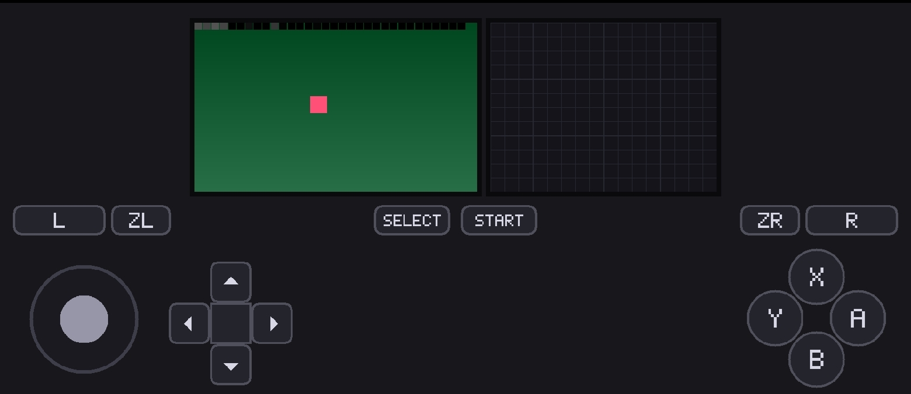

# Native-port
Clean-room native Android (10+) port of Ocarina of Time 3D.
No Nintendo code, ROMs, or assets in this repo. Users supply their own dump.

Plan: understand game logic (zeldaret/oot3d) → SDL platform layer →
Vulkan/GLES renderer → Android NDK build (minSdk 29, arm64-v8a) → GitHub Actions CI.

still on development and MIGHT not release
